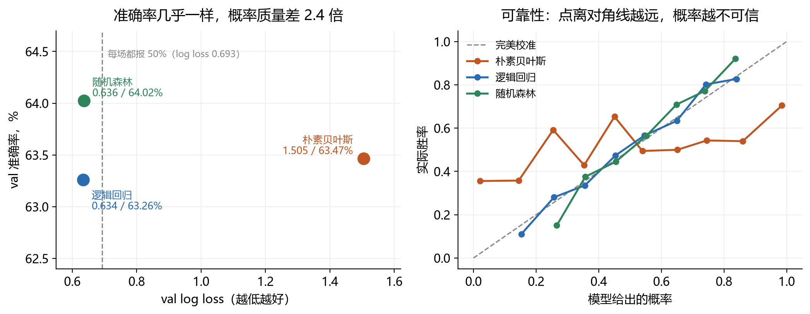

# 三个模型学习手册

## 朴素贝叶斯 · 逻辑回归 · 随机森林

本手册对应组内最终分工：我负责这三个模型的原理讲解、训练实现与结果分析。

**三个模型使用完全相同的实验条件**：同一份 clean_v2 冻结数据、同一批 41 列特征、
同一条时间切分、同一套镜像扩增与 365 天样本权重。唯一变化的只有分类器本身。
逻辑回归分支逐场复现了发布版 M2（最大概率差 3.3e-16），说明三者的对照条件完全一致。

## 结果一览

| 模型 | val 准确率 | val log loss | val ECE | 覆盖 50% 时准确率 |
|---|---:|---:|---:|---:|
| 朴素贝叶斯 | 63.47% | 1.5052 | 0.2639 | 63.47% |
| 逻辑回归 | 63.26% | 0.6338 | 0.0246 | 71.75% |
| 随机森林 | 64.02% | 0.6357 | 0.0310 | — |

## 三个模型的准确率与概率质量



## 怎么读这份手册

1. 先看「公共协议」一节，理解三个模型共用的四道工序。
2. 每一章的结构相同：一句话原理 → 数学形式 → 代码逐行解释 → 结果 → 结论 → 可能被问到。
3. 最后「放在一起看」一节给出三者对比与答辩口径。

## 公共协议（三个模型都一样）

| 工序 | 做什么 | 为什么 |
|---|---|---|
| 镜像扩增 | 每场复制成两队互换的两行，特征取负、标签翻转 | 原始数据里「队 1 通常更强」，不做的话模型会学成"猜队 1" |
| 样本权重 | `w = 0.5 ** (age_days / 365)` | 三年前的比赛参考价值低于上个月的 |
| 时间切分 | 训练期内部五折向前，每折隔离 30 天 | 绝不能用未来预测过去 |
| 只预测不拟合 | 每折的留出部分只做预测 | 否则就是拿答案调模型 |

四道工序的具体代码，在每一章的「代码逐行解释·第一步」里都会再出现一次。


# 一、朴素贝叶斯（Gaussian Naive Bayes）

## 一句话

**用贝叶斯公式算「给定这些特征，队 1 赢的概率」，并假设各个特征在给定胜负之后互相独立。**

## 为什么叫「朴素」

贝叶斯公式本身是对的：

```
P(赢 | 特征) ∝ P(特征 | 赢) × P(赢)
```

麻烦在 `P(特征 | 赢)`：41 个特征要估计一个 41 维的联合分布，参数量爆炸。

于是加一个**很朴素的假设**：给定胜负之后，各个特征互相独立。于是

```
P(特征 | 赢) = P(x₁|赢) × P(x₂|赢) × … × P(x₄₁|赢)
```

41 个一维分布就够了。**这就是"朴素"两个字的来源——它是一个为了算得动而作出的、几乎一定不成立的假设。**

"Gaussian" 指的是：假设每个 `P(xⱼ|赢)` 都是正态分布，用训练数据估出均值和方差就行。

## 代码逐行解释

### 第一步：镜像扩增（三个模型共用的公共协议）

```python
both, yb = np.vstack([X, -X]), np.r_[y, 1 - y]
```

| 代码 | 在干什么 | 为什么必须这么写 |
|---|---|---|
| `np.vstack([X, -X])` | 把特征矩阵复制一份，**每一列取负**，上下叠起来 | 原始数据里「队 1 通常更强」，模型会学成"猜队 1"。交换两队后所有差值特征变号，这个偏置就抵消了 |
| `np.r_[y, 1 - y]` | 标签同样翻转：原来的 0 变 1，1 变 0 | 队伍互换后胜负也互换 |
| 行数从 7,260 变 14,520 | 数据翻倍 | 这是**数据增强**，不是采样 |

> 关键：扩增只作用在**拟合**上。预测时仍用原始方向的 1,968 场，绝不翻转。

### 第二步：样本权重

```python
sample_weight=np.tile(w, 2)
```

| 代码 | 在干什么 | 为什么 |
|---|---|---|
| `w = weights(TRAIN)` | 每场比赛一个权重，365 天半衰期 | 三年前的比赛参考价值低于上个月的 |
| `np.tile(w, 2)` | 权重也复制一份 | 镜像后的两行共享同一个权重 |

`weights()` 的实现：`0.5 ** (age_days / 365)`。今天的比赛权重 1.0，一年前 0.5，两年前 0.25。

### 第三步：训练

```python
m = GaussianNB(var_smoothing=smoothing)
m.fit(both, yb, sample_weight=np.tile(w, 2))
```

| 参数 | 含义 | 这里为什么这么设 |
|---|---|---|
| `var_smoothing` | 给每个方差加一个很小的数，防止方差为 0 导致除零 | 默认 `1e-9`。**这个参数直接决定概率有多"自信"**，见下面的结果 |

### 第四步：预测

```python
lambda Z: m.predict_proba(Z)[:, 1]
```

| 代码 | 含义 |
|---|---|
| `predict_proba(Z)` | 返回形状 `(n, 2)`，两列分别是 P(类 0)、P(类 1) |
| `[:, 1]` | 取第二列 = P(队 1 赢) |

**注意：这里没有做任何额外处理**，不像逻辑回归还要乘一个温度系数。朴素贝叶斯输出的就是它自己算出来的概率。

## 结果

| 配置 | val 准确率 | val log loss | val ECE |
|---|---:|---:|---:|
| `var_smoothing=1e-9`（默认） | 63.47% | **1.5052** | 0.2639 |
| `var_smoothing=1e-6` | 63.57% | 1.4364 | 0.2593 |
| `var_smoothing=1e-3` | 63.16% | 0.6998 | 0.1078 |
| `var_smoothing=0.1` | 61.03% | 0.6651 | 0.0463 |
| `var_smoothing=1` | 60.62% | 0.6643 | 0.0515 |

参照：每场都报 50% 的 log loss 是 **0.6931**。

## 为什么 log loss 会到 1.5

**因为独立假设不成立，而它不知道。**

我们的 41 列里有大量高度相关的特征：

- `diff_elo`（Elo 差）
- `diff_graph90` / `diff_graph270`（图论实力）
- `diff_opponent_strength`（对手强度）

它们说的其实是**同一件事**：谁更强。

朴素贝叶斯假设它们独立，于是把同一份证据**重复累加了 3–4 次**，得到的对数几率被放大好几倍。再经过 sigmoid，概率就被推到 0.001 或 0.999。

后果：

- **猜对时**：预测 0.999，真实 1 → log loss ≈ 0.001，几乎没奖励
- **猜错时**：预测 0.999，真实 0 → log loss ≈ 6.9，**罚到死**

准确率还能有 63.47%，因为只看"哪个类概率更大"；但概率本身完全不可用。

**加平滑能缓解一点**（`var_smoothing=1` 时 log loss 降到 0.6643），但代价是准确率掉到 60.62%——把方差撑大，等于人为把概率压回 0.5 附近，是一种粗暴的"降温"。

## 一句话结论

> 朴素贝叶斯的准确率 63.47%，比正式模型还高，但 log loss 是 1.51 —— **它证明「准确率高 ≠ 概率可用」，也是我们以 log loss 为主指标的直接证据。**

## 可能被问到

**Q：为什么不调参把它调好？**
A：调了。`var_smoothing` 从 1e-9 调到 1，log loss 从 1.51 降到 0.664，但准确率从 63.47% 掉到 60.62%。本质问题是独立假设，调参只能掩盖，不能解决。

**Q：既然这么差，为什么还做？**
A：它在大纲 §2b（Bayes' rule & MAP classifiers），是课内要求。更重要的是，它给"为什么必须用 log loss"提供了最有说服力的反例。

**Q：它跟逻辑回归什么关系？**
A：朴素贝叶斯是**生成模型**（学 P(x|y) 再转成 P(y|x)），逻辑回归是**判别模型**（直接学 P(y|x)）。数据够多时判别模型通常概率更准，这就是我们看到的。

---


# 二、逻辑回归（Logistic Regression）

## 一句话

**假设胜负的对数几率是 41 个特征的线性组合，用交叉熵训练出权重，再用 sigmoid 压回 0–1。**

它是我们的**正式模型（M2）**。

## 原理

### 两步

```
第一步：z = w₁x₁ + w₂x₂ + … + w₄₁x₄₁        （线性组合，算出"实力差"）
第二步：p = 1 / (1 + e^(−z))                  （sigmoid，压到 0–1）
```

`sigmoid` 的作用：`z` 从 −∞ 到 +∞，`p` 就从 0 到 1 平滑变化。`z=0` 时 `p=0.5`（五五开），`z=+2` 时 `p≈0.88`。

### 它和线性回归的区别

线性回归直接输出一个数，可能小于 0 或大于 1；逻辑回归多套了一个 sigmoid，所以输出一定是概率，而且**它用的损失是交叉熵而不是平方误差**——这就是为什么它的概率比别的模型更可信。

### 怎么训练

最小化交叉熵：

```
Loss = −(1/n) Σ [ yᵢ·log(pᵢ) + (1−yᵢ)·log(1−pᵢ) ]
```

这个式子就是 log loss。**训练目标和评价指标是同一个东西**，所以它在 log loss 上天然占优——这是后面结果的关键。

再加一个 L2 正则（`C` 参数）防止过拟合：

```
Loss_total = Loss + (1/C)·‖w‖²
```

`C` 越小，正则越强，权重被压得越接近 0。

## 代码逐行解释

### 第一步：镜像扩增（公共协议）

```python
both = np.vstack([X, -X])
```

把特征复制一份、每列取负、上下叠起来。原始数据里队 1 通常更强，不这么做模型会学成"猜队 1"。

### 第二步：标准化

```python
sc = StandardScaler(with_mean=False).fit(both)
```

| 参数 | 为什么 |
|---|---|
| `with_mean=False` | **不减均值**。因为镜像之后数据关于 0 对称，均值本来就是 0；更重要的是，减均值会破坏"正负对称"这个结构 |
| 只除以标准差 | 让 41 个特征量纲一致。`diff_elo` 可能是 ±400，`diff_win_rate10` 只有 ±0.5，不缩放的话 Elo 会独占权重 |

### 第三步：训练

```python
m = LogisticRegression(C=LR_C, fit_intercept=False, max_iter=1200)
m.fit(sc.transform(both), np.r_[y, 1 - y], sample_weight=np.tile(w, 2))
```

| 参数 | 值 | 为什么这么设 |
|---|---:|---|
| `C` | **0.001** | 很强的 L2 正则。7,260 场 × 41 列、且特征高度相关，强正则可以防止某些相关特征拿到夸张的权重 |
| `fit_intercept` | **False** | **这是对称化的要求**。截距项不随队伍互换而变号，而标签是翻转的——有截距会破坏对称，数学上它的最优解就是 0，不如直接设 False |
| `max_iter` | 1200 | lbfgs 求解器的迭代上限，够收敛就行 |

### 第四步：预测（注意这里有个额外步骤）

```python
lambda Z: expit(m.decision_function(sc.transform(Z)) * LR_MULT)
```

| 代码 | 含义 |
|---|---|
| `decision_function` | 返回 `z`（还没过 sigmoid 的线性分数） |
| `expit(...)` | 就是 sigmoid 函数 |
| `* 1.15` | **温度缩放**：把分数放大 15%，让概率更陡一点 |

**`1.15` 是怎么来的？** 在训练期五折的合并 log loss 上搜出来的——1.15 时 log loss 最低。它的作用是校正模型"过于保守"的倾向（强正则会压低分数幅度）。

**这一步很重要**：它说明即使是逻辑回归，也可能需要一点校准才能把概率调到最优。

## 结果

| 口径 | 准确率 | log loss | Brier | ECE |
|---|---:|---:|---:|---:|
| 训练期留出（OOF，6,185 场） | 61.47% | 0.6521 | 0.2302 | 0.0146 |
| 开发验证（val，1,968 场） | 63.26% | **0.6338** | 0.2218 | 0.0246 |
| **最终测试（2,159 场）** | **62.76%** | **0.6332** | 0.2216 | **0.0185** |

在三个模型里：**log loss 最低、ECE 最低、50% 覆盖率下准确率最高。**

## 为什么它的概率最好

三个原因，缺一不可：

1. **直接对概率建模**。它学的就是 `P(y=1|x)`，不像朴素贝叶斯要绕一圈先学 `P(x|y)`。
2. **训练目标就是 log loss**。损失函数和评价指标是同一个，所以它不可能在"我训练的东西"和"你们评估的东西"之间错位。
3. **强正则 + 温度缩放**。`C=0.001` 压住权重幅度，`×1.15` 再把幅度调回来，两步让概率既不过度自信也不过于保守。

## 一句话结论

> 逻辑回归没有非线性、没有集成，但 **log loss 0.6338 是三者最低、ECE 0.0246 也最低**。在 41 列、7,260 场的规模上，线性可加已经足够——**它是唯一同时拿到最好概率质量和接近最高准确率的模型。**

## 可能被问到

**Q：为什么正式模型用它，而不用准确率更高的随机森林？**
A：因为我们的目标不是"猜对多少"，而是"概率可不可信"。随机森林准确率高 0.76pp（在噪声内），但 log loss 和 ECE 都更差。判据是概率质量。

**Q：`C=0.001` 是不是太强了？**
A：是在训练期五折里搜出来的，不是拍的。而且这个数据特征高度相关（Elo、图论实力、对手强度说的是同一件事），强正则能防止权重被相关特征分摊得乱七八糟。

**Q：为什么没有截距？**
A：因为做了镜像扩增（每场复制成两队互换的两行、标签翻转）。在这种对称数据上，截距的最优解恒为 0，设 `fit_intercept=False` 是让优化器少走弯路。

**Q：`×1.15` 算不算调参调过头？**
A：它是在**训练期**的五折上选的，验证集和测试集都没参与。而且它只有一个参数，属于标准的"温度缩放"做法。

---


# 三、随机森林（Random Forest）

## 一句话

**训练很多棵决策树，每棵只看数据的一部分和一个随机特征子集，最后把所有树的概率平均。**

它是我们的**基线模型（M1）**，也是用来量化 bagging 贡献的工具。

## 原理

### 先说单棵决策树

一棵树就是一连串「是 / 否」问题：

```
diff_team_player > 0.15 ?
├─ 是 → diff_elo > 0.4 ?  → 是：赢 (72%)  否：赢 (58%)
└─ 否 → diff_opponent_tier > 0.1 ?
        ├─ 是：赢 (55%)
        └─ 否：输 (38%)
```

叶子节点的百分比就是预测概率。

**问题**：树可以一直分下去，直到每个叶子只剩一场比赛。这时训练集准确率 100%，但换一批数据就崩——**方差极大**。

### 随机森林怎么修

两个"随机"：

1. **Bootstrap 采样**：每棵树用**有放回抽样的**一份数据训练。大约 63% 的原始样本会被抽到，剩下 37% 没出现（叫 out-of-bag）。
2. **随机特征子集**：每次分裂时，只从 41 个特征里随机选 √41 ≈ 6 个来挑最优分裂点。

然后把 128 棵树的预测概率**取平均**。

**为什么有效**：单棵树换个样本就变（方差大），但 128 棵独立的树，各自犯的错互相抵消——平均之后方差被压下去。这叫 **bagging**（Bootstrap AGGregating）。

**注意一个细节**：随机森林各棵树之间是**并行**训练的，互相不依赖。这和 boosting（AdaBoost、LightGBM）不同——boosting 是串行地一棵修前一棵的错。

## 代码逐行解释

### 第一步：镜像扩增（公共协议）

```python
both = np.vstack([X, -X])
```

同另外两个模型。展开后的 14,520 行里，每一对是「同一场比赛，两队互换」。

### 第二步：训练

```python
m = RandomForestClassifier(
        n_estimators=128,
        min_samples_leaf=36,
        max_features="sqrt",
        n_jobs=1,
        random_state=SEED)
m.fit(both, np.r_[y, 1 - y], sample_weight=np.tile(w, 2))
```

| 参数 | 值 | 为什么这么设 |
|---|---:|---|
| `n_estimators` | **128** | 树的数量。再多收益递减，128 棵之后平均效果基本稳定 |
| `min_samples_leaf` | **36** | **每个叶子至少 36 场**。这是防过拟合的关键——没有这个限制，树会长到每叶一场，必然过拟合。36 约等于 14,520 的 1/400 |
| `max_features` | **`"sqrt"`** | 每次分裂只考虑 √41 ≈ 6 个特征。这是随机森林的第二个"随机"，作用是**让各棵树长得不一样**（增加多样性），否则所有树都会先挑同一个最强特征 |
| `n_jobs` | 1 | 单线程，保证结果可复现 |
| `random_state` | 2026 | 固定随机种子，别人重跑能得同样结果 |

样本权重 `sample_weight` 同样是 365 天半衰期——越近的比赛对树的分裂影响越大。

### 第三步：预测

```python
lambda Z: m.predict_proba(Z)[:, 1]
```

| 代码 | 含义 |
|---|---|
| `predict_proba(Z)` | 返回 `(n, 2)`，代表 **128 棵树预测概率的平均值** |
| `[:, 1]` | 取 P(队 1 赢) |

**关键点**：随机森林的概率是"投票的平均"，它没有经过任何校准。树越多、叶子越纯，平均后的概率越容易走向 0 和 1——这就是它 log loss 略差于逻辑回归的原因。

## 结果

### 同一批 41 列、同一套切分下的三模型对比

| 模型 | val 准确率 | val log loss | val ECE |
|---|---:|---:|---:|
| 朴素贝叶斯 | 63.47% | 1.5052 | 0.2639 |
| 逻辑回归 | 63.26% | **0.6338** | **0.0246** |
| **随机森林** | **64.02%** | 0.6357 | 0.0310 |

**准确率最高（64.02%），但 log loss 和 ECE 都略差于逻辑回归。**

### bagging 到底值多少（同 41 列、同叶子下界）

| 模型 | val 准确率 | val log loss |
|---|---:|---:|
| 单棵决策树（不限深度，叶子≥36） | 57.72% | 0.8560 |
| **随机森林（128 棵）** | **64.02%** | **0.6357** |

**只差"一棵树 vs 128 棵树"：log loss 降 0.22，准确率涨 6.3 个百分点。**

这就是 bagging 的全部功劳——它不改变单棵树的偏差，只降低方差。

## 为什么准确率最高但概率略差

因为**平均概率不等于校准好的概率**。

单棵树在叶子里算出的是"这个叶子里的胜率"，叶子越纯，值越接近 0 或 1。128 棵树的平均会让它柔和一些，但仍然不等于真实频率。

实测：随机森林 ECE 0.0310，逻辑回归 0.0246——**差 0.6 个百分点**。这说明它略偏自信，而逻辑回归因为直接用交叉熵训练，校准得更好。

## 一句话结论

> 随机森林准确率 64.02% 是三者最高，但 log loss 0.6357、ECE 0.0310 都略逊于逻辑回归。对比单棵树的 0.8560，**bagging 把方差压下去的效果非常明显**——但它买到的是准确率，不是概率质量。

## 可能被问到

**Q：随机森林比决策树强在哪？**
A：只强在方差。单棵树的偏差和森林里的树一样，但森林把 128 棵高方差的树平均起来，方差大幅下降。证据：同条件下 log loss 从 0.8560 降到 0.6357。

**Q：为什么 `min_samples_leaf=36` 而不是默认的 1？**
A：默认的 1 会允许每棵叶子只剩一场比赛，必定过拟合。36 是 M1 就用过的值，我们沿用是为了保持可比。实测深度不限、叶子≥36 的单树 val 准确率 57.72%——说明光是限制叶子还不够，必须靠 bagging。

**Q：为什么不调参把随机森林调到最好？**
A：调过组合了（M1 时期以及这次 41 列版），但**调参不能解决概率校准问题**——那是模型结构决定的。要更好的概率，该换的是模型类型（逻辑回归）或加校准层，不是继续调森林。

**Q：随机森林和 LightGBM 什么关系？**
A：都是树集成，但随机森林是**并行 + bagging**（降方差），LightGBM 是**串行 + boosting**（降偏差）。我们的实验里 LightGBM 准确率 63.67%、log loss 0.6365，也没有赢过逻辑回归。

---


# 四、放在一起看

## 三个数字最重要的一件事

- **准确率**：63.47% / 63.26% / 64.02%，最大差 0.76 个百分点。
  1,968 场的验证集，抽样标准误约 1 个百分点——**这三个数在统计上分不出高低。**
- **log loss**：1.5052 / 0.6338 / 0.6357。朴素贝叶斯是最差的 **2.4 倍**。
- **ECE**：0.2639 / 0.0246 / 0.0310。朴素贝叶斯的校准误差是逻辑回归的 **10 倍**。

**结论：准确率这三列几乎没有信息量，log loss 和 ECE 才能把三个模型分开。**

这就是本项目以 log loss 为主指标、并要求校准的全部理由。

## 三个模型各自教会我们什么

**朴素贝叶斯 → 准确率高不等于概率可用。**
它假设特征在给定胜负后互相独立。我们的 41 列里 Elo、图论实力、对手强度说的是同一件事，
被当成独立证据重复累加，对数几率被放大数倍，概率被推到 0 和 1。
猜对时没奖励，猜错时代价极大。

**逻辑回归 → 简单模型可以是最好的概率模型。**
它直接对概率建模，训练用的交叉熵就是评价用的 log loss，两者不错位。
加上强正则（C=0.001）与温度缩放（×1.15），概率既不过度自信也不过于保守。

**随机森林 → 复杂度买得到准确率，买不到概率。**
128 棵树平均把方差压下去，准确率最高；但平均概率不等于校准好的概率，ECE 仍略差。
对比单棵树（log loss 0.8560 → 0.6357），bagging 的贡献被量化得很清楚。

## 与项目主线的关系

这三个模型不是孤立的三次实验，它们共同支撑项目的一句话结论：

> 换特征能提升 1.7 个百分点（M1 → M2），换模型只能提升 0.2–0.8 个百分点且概率质量退步。
> **瓶颈在特征，不在模型。**

## 答辩口径（每个模型一句话）

- **朴素贝叶斯**：「它假设特征互相独立，这个假设在我们的数据上明显不成立——
  准确率还有 63.47%，但 log loss 是 1.51，概率被推到了 0 和 1。它是我们选主指标的证据。」
- **逻辑回归**：「它直接对概率建模、用交叉熵训练，所以概率天然可信。
  log loss 0.6338 三者最好，ECE 只有 0.0246。正式模型选它。」
- **随机森林**：「bootstrap 加多树平均降低方差。准确率 64.02% 最高，但概率略逊。
  它证明加复杂度能换准确率，换不来概率质量。」

## 补充说明

三个模型在**最终测试集**上的数字（2,159 场）：

| 模型 | 测试准确率 | 测试 log loss | 测试 ECE |
|---|---:|---:|---:|
| M1 随机森林（31 列） | 62.67% | 0.6480 | 0.0350 |
| M2 增强逻辑回归（41 列） | 62.76% | 0.6332 | 0.0185 |

测试集只评估一次，评完即锁定，不参与任何调参。朴素贝叶斯没有在测试集上评估——
它的验证集 log loss 已经明显不可用，不必占用唯一一次测试机会。
